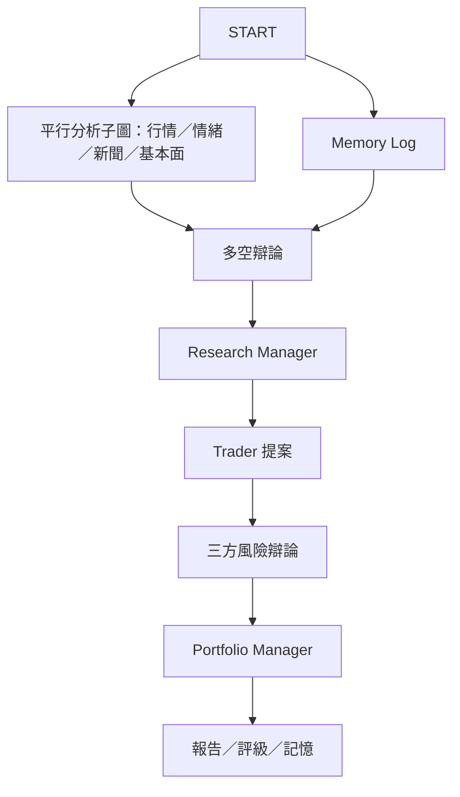

# A. 原版架構盤點與風險

盤點日：2026-10-13。實際來源為官方 TauricResearch/TradingAgents，commit
`1394a3f72aa4393e1a98f51b382434c4b4c2d972`，套件版本 0.6.0。
已透過 GitHub 連接器識別並 clone 使用者 Fork `wei0223/taiwan-tradingagents`，
其 main SHA 與上述官方版本完全相同；本文件已比對實際 Fork 程式與相依宣告。所有開發均在
`feature/taiwan-market-provider`，已推送同名分支並建立 draft PR #1，未修改 main。

## 實際架構

| 範圍 | 程式碼證據 | 行為與限制 |
|---|---|---|
| Graph 入口 | `graph/trading_graph.py` TradingAgentsGraph | 建立兩個 LLM tier、memory、checkpointer；propagate 驗證日期，綁定 run_config。初始化即建立 LLM client。 |
| 工作流程 | `graph/setup.py` GraphSetup.setup_graph | START 同時啟動所選 market/social/news/fundamentals 子圖及 Memory Log；等待全部完成後進入 Bull Researcher。子圖各自有工具及獨立訊息歷史，max_tool_rounds 限制工具迴圈。 |
| 狀態／路由 | `agents/state.py`, `graph/conditional_logic.py` | AgentState 保存分析報告、兩組辯論、投資計畫、最終評級及 portfolio_context。多空各 N 回合，風險三人各 N 回合。 |
| 多空研究 | `agents/researchers/*`, `agents/managers/research_manager.py` | Bull / Bear 輪流引用分析報告；Research Manager 用 deep tier 產生 ResearchPlan。辯論本身不是數值計算或績效證明。 |
| 決策及風險 | `agents/trader/trader.py`, `agents/risk_mgmt/*`, `agents/managers/portfolio_manager.py`, `agents/schemas.py` | Trader 產生 Buy/Hold/Sell 提案；Aggressive → Conservative → Neutral 辯論；Portfolio Manager 產生五級評級。結構化輸出失敗有文字 fallback。entry/stop 等仍可能由 LLM 產生；不是程式化硬風控。 |
| 資料切換 | `dataflows/router.py` | TOOLS_CATEGORIES + VENDOR_METHODS；tool_vendors 優先於 data_vendors。只依明示的逗號 vendor chain fallback；default 才遍歷可用供應商。typed errors 區分空資料、無法連線、未設定。 |
| 執行設定 | `dataflows/config.py`, `default_config.py` | ContextVar 隔離 run，deepcopy 設定；預設 Yahoo 行情/指標、SEC EDGAR→Yahoo 財報、Yahoo 新聞、FRED、Polymarket。 |
| 日期防護 | `agents/tools.py`, `dataflows/date_window.py` | InjectedState 固定分析股票／日期，as_of / as_of_window 截斷工具要求；底層各 vendor 仍須自行實作 publication-time 防護。 |
| 行情與技術 | `dataflows/vendors/yahoo/{ohlcv,market,snapshot}.py`, `vendors/alpha_vantage/{stock,indicator}.py` | Yahoo OHLCV 快取／新鮮度防護；stockstats 程式計算指標；snapshot 提供可信數值。snapshot 直接讀 Yahoo，未走 vendor registry。 |
| 基本面 | `vendors/yahoo/fundamentals.py`, `vendors/sec_edgar.py`, `vendors/alpha_vantage/fundamentals.py` | overview、BS、CF、IS、insider；美國 SEC as-filed 財報不能套用台灣公司。原版沒有台股月營收及三大法人專用工具。 |
| 非路由資料入口 | `agents/context.py`, `memory/settlement.py` | 公司 identity 直接取 Yahoo；settlement 用 Yahoo 價格算 realized/benchmark return。台股 provider 接線必須一併處理。 |
| LLM | `llm_clients/factory.py`, `openai_client.py`, `api_key_env.py` | lazy provider factory；quick/deep 可不同供應商；支援 Ollama。原版 DEFAULT_CONFIG 指向付費 OpenAI 模型。 |
| CLI | `cli/main.py`, `cli/run.py`, `cli/{config,selections,prefs,display}.py` | Typer analyze / backtest，有 flags 非互動模式、stream 顯示、checkpoint、偏好保存。 |
| 回測 | `backtest.py`, `memory/{log,settlement,reflection}.py` | ticker/date grid 決策評估，独立 run log、續跑、五級評級方向命中率及 alpha；不是有現金／成交／部位遞移的交易模擬器。reflection 可能呼叫 LLM。 |
| 報告 | `reporting.py`, `report_html.py` | CLI/API 共用 writer，分章 Markdown、complete_report.md、自包含 HTML，记录版本/model/vendor/日期。沒有通用原始資料 lineage archive。 |
| 測試／CI | `tests/*`, `tests/conftest.py`, `.github/workflows/ci.yml` | pytest 非 integration 預設封鎖 socket/curl 網路、假 key、隔離 cache/config。CI Python 3.11–3.14 + timezone、乾淨安裝、全庫 Ruff。 |

## 相依套件盤點

直接讀 `pyproject.toml`：Python >=3.11；langchain-core >=1.6.5、anthropic >=1.7.4、
google-genai >=4.4.0、openai >=1.6.6；langgraph >=1.2.12、checkpoint-sqlite >=3.1.1；
pandas >=3.0.6、stockstats >=0.6.5、yfinance >=1.7.0、requests >=2.32.4；
dotenv、pytz、questionary、rich、typer、typing-extensions、markdown-it-py。
dev extras：pytest、pytest-subtests、ruff；bedrock 為 optional langchain-aws。
`requirements.txt` 只有 `.`，以 pyproject 為唯一依據。沒有 lockfile；這些是宣告下限，
不是本機已安裝版本。安裝及測試實況見 validation.md。

## 風險與處置

| 等級 | 風險 | 第一版決定／後續驗收 |
|---|---|---|
| 高 | 財報 quarter end／營收 period 被誤當公布日；修訂資料可能穿越 | 保存 raw date、period、published_at、retrieved_at；未知 publication 排除，不能用法定期限猜日期。未有 vintage archive 不宣称可重現歷史基本面。 |
| 高 | 快照、identity、settlement 直接 Yahoo，造成 mixed-source | 第一版独立 data-only CLI，不宣称已接完整 Graph；後續抽象这三條旁路並寫 Graph Mock 測試。 |
| 高 | 原版預設付費 LLM | 台股入口完全不初始化 Graph/LLM；後續本機 Ollama opt-in profile；保留上游設定相容性。 |
| 高 | LLM entry/stop/size 不是硬風控，數值可能幻覺 | 第一版僅程式計算資料，不產生交易建議，不加入 broker；後續 deterministic risk validator 才可稱風控計算。 |
| 高 | 今日股票市場別 metadata 不等於歷史掛牌狀態 | 查最新 metadata 用於當前代碼轉換，標明 identity snapshot；歷史 membership 需 TWSE/TPEx 生效區間，不能倒推。 |
| 中 | 未還原行情遇除權息／分割、單位誤解 | 台股 OHLCV 標示 TWD、股、unadjusted；避免跨供應商混算。調整價及 corporate actions 後續實作。 |
| 中 | 法人漏列、日期缺漏被當零或連買 | 缺資料返回 unavailable；連續天數需價格交易日期完整覆蓋，缺漏中止，窗口左側截斷需標記。 |
| 中 | 季累計與單季混用、EPS 負基期／零基期 | 明示季別與單季 contract；零或非正基期 growth=null，不能任意補值；EPS 不直接做 YTD 差分。 |
| 中 | HTTP quota/auth/timeout、key 外洩 | timeout、typed unavailable、Authorization header、FINMIND_TOKEN 環境變數；不保存 key/HTTP error URL。 |
| 中 | 最小版本範圍寬，Python/平台依賴變動 | 保存實際安裝診斷，不偽稱全套通過；保留上游 CI，新增專用離線測試。 |
| 中 | 台股成本／漲跌停／融券／交易曆缺失 | 原版回測僅評級；台股投組回測、交易成本與限制後續，禁止實單。 |
| 中 | API 授權與可重分發 | 開源程式與 synthetic fixtures；不隨程式重分發使用者 token 或付費資料，資料授權另核查。 |

## 架構確認

採 additive 台股 package + provider protocol + injected transport，不重寫上游 Graph。
第一版接受可獨立測試／匯出資料的 MVP；完整 Agent integration 不與 MVP 混為同一項完成。
後續上游升級若不同於上述 SHA，必須重新比對介面及測試後套用。
